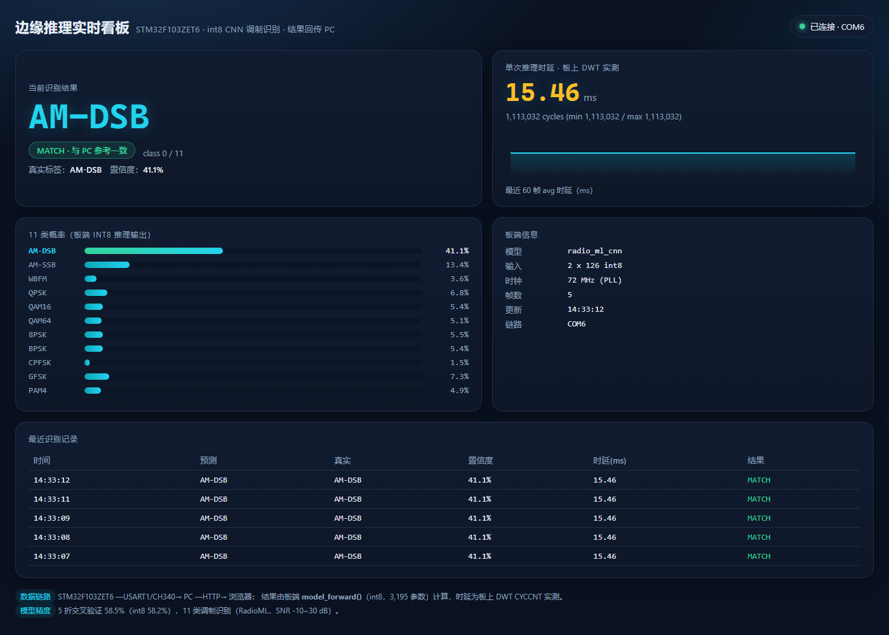

# edge-inference：面向 MCU 的通用开源边缘推理框架

把分类神经网络（CNN / MLP / …）量化为 **int8**，自动导出成 **C 数组 + 纯 C 前向推理**，
在资源受限的 MCU（本仓库以 **STM32F103ZET6** 为目标）上跑推理、测时延，
并把**分类结果实时回传到 PC 的 Web 看板**。

框架与任务无关：当前示例任务是 **RadioML 2018 的 11 类调制识别**，换任务只需重训 + 重新导出。

> 当前状态：**Phase 2 / 3 完成**——tiny CNN 训练、int8 量化、C 数组导出、PC 逐位对齐、
> STM32F103 板载实测（15.5 ms/次）、**结果回传 PC 的实时看板**均已跑通。

> **路径说明**：文中出现的 `<仓库路径>` 等绝对路径是本机示例，
> 在别的机器上请替换成实际仓库路径；Python/工具链路径同理。

## 当前进度

- [x] **Phase 1** PC 侧跑通：int8 推理库 + PyTorch → C 数组导出 + 输出对齐
- [x] **Phase 2** 调制识别 tiny 模型：RadioML 11 类、550 条 I/Q → tiny CNN → int8 → `models/model.c`
- [x] **C 库扩展** `conv1d` / `maxpool` / `avgpool` / `requantize`（逐位 100% 对齐）
- [x] **序列算子扩展** GRU / LayerNorm / attention / softmax（float32 参考实现，numpy 对齐）
- [x] **固件** STM32F103ZET6：USART1 + 72 MHz PLL（HSE 失败回退 HSI）+ DWT CYCCNT 时延统计
- [x] **Phase 3** 板载烧录实测：72 MHz PLL 起振、pred=0 MATCH、**≈15.5 ms/次**（DWT 实测）
- [x] **时延优化**：requantize 定点化 + 卷积热循环搬 SRAM，**33.2 ms → 15.5 ms（−53.4%）**
- [x] **结果回传 PC**：串口 → `demo/server.py` → Web 实时看板（类别/概率/时延/历史）
- [ ] **Phase 4** 开源发布（GitHub/Gitee）与更多硬件对比（可选）

## 系统链路

```
┌──────────────────┐   USART1 (PA9/PA10)   ┌─────────────┐   HTTP    ┌──────────────┐
│ STM32F103ZET6    │ ────────────────────> │ CH340 (COM6)│ ────────> │ 浏览器实时看板 │
│ int8 CNN 推理     │  115200 8N1, 每 ~1.7 s │  PC 串口     │  demo/server.py           │
│ 15.5 ms/次        │  打印一帧分类结果       │  解析帧      │  每 500 ms 刷新            │
└──────────────────┘                        └─────────────┘           └──────────────┘
```



## 结果速览（RadioML 11 类，550 条，SNR -10~30 dB）

| 指标 | 数值 |
|---|---|
| 模型 | tiny 1D-CNN：2×126 → conv(k7,s2)×16 → pool2 → conv(k5,s2)×32 → pool2 → GAP → FC11 |
| 参数量 | **3,195**（int8 权重 3,136 B + int32 偏置 236 B） |
| 5 折交叉验证准确率（浮点） | **58.55%** |
| 5 折交叉验证准确率（int8，OOF） | **58.18%**（量化掉点仅 **0.36 pt**） |
| 每类准确率 | AM-DSB / AM-SSB / WBFM / GFSK 100%，CPFSK 94%；QPSK/QAM/PSK/PAM4 ≈20%（互相混淆） |
| PC 端单次推理 | ≈30 µs（MSVC /O2，x86，实测 24~32 µs） |
| STM32F103 @72 MHz | **实测 15.5 ms/次**（1,113,032 cycles，DWT；优化前 33.2 ms，−53.4%） |
| 固件占用 | Flash **29.6 KB（5.8% / 512 KB）**，RAM **15.6 KB（23.9% / 64 KB）**（含 .ramfunc 952 B 与分阶段 benchmark） |
| 板端结果一致性 | 11 类概率与 PC/numpy **完全一致**（pred=0 MATCH） |

> 说明：550 条样本 + 3 千参数模型，58% 是小样本下的合理结果；AM/FM 类可 100% 分离，
> PSK/QAM 类因 8 倍抽取丢失相位细节而混淆。12 组精度提升实验的结论见
> [docs/phase2_调制识别模型.md](docs/phase2_调制识别模型.md) §10。

## 目录结构

```
edge-inference/
├── start_demo.bat         # 一键启动 Web 看板（板子结果回传 PC）
├── csrc/
│   ├── nn.h / nn.c        # 纯 C 推理库：int8 fc/conv1d/pool/requantize + f32 GRU/LayerNorm/attention
│   └── demo.c             # PC 端示例：内置样本 -> model_forward -> 打印概率与耗时
├── demo/                  # 板子 → PC 实时看板
│   ├── server.py          # 串口解析 + HTTP 服务（零 Web 框架，仅 pyserial）
│   └── static/index.html  # 看板前端（类别/概率/时延曲线/历史）
├── models/                # 由 tools/train_modrec.py 生成
│   ├── model.h / model.c  # int8 权重数组 + model_forward()（无 Python 运行时也能推理）
│   ├── demo_sample.h      # 一条真实样本的 int8 特征（C demo / 固件内置）
│   ├── modrec_meta.json   # 量化参数（scale / bias / 形状 / 预处理说明）
│   ├── modrec_metrics.json# 交叉验证、逐 SNR/逐类精度、混淆矩阵、模型大小
│   └── modrec_cnn.pt      # PyTorch 权重（复现/再量化用）
├── tools/
│   ├── train_modrec.py    # Phase 2：训练 + 交叉验证 + int8 量化 + 导出 C
│   ├── quantize.py        # 量化 / 整数前向模拟 / C 代码生成
│   └── export_model.py    # 旧 Phase 1 两层 MLP 导出（保留作对比，输出 legacy_*.h）
├── tests/
│   ├── test_conv_parity.py   # C 算子 vs numpy：57 用例 / 10451 元素 / 100% 逐位一致
│   ├── test_model_parity.py  # 导出 model.c vs numpy：550/550 argmax 一致，概率误差 5e-10
│   ├── test_seq_ops_parity.py# GRU/LayerNorm/attention vs numpy：102 元素，误差 ~2e-7
│   └── test_roundtrip.py     # 旧 Phase 1 MLP 对齐测试
├── firmware/
│   ├── src/main.c         # USART1 + 72 MHz PLL + DWT 时延统计 + 分阶段 benchmark + RAM 遥测
│   ├── build.bat          # arm-none-eabi-gcc 一键编译（elf/bin/hex/size）
│   ├── tools/flash.bat    # OpenOCD + CMSIS-DAP 一键烧录
│   ├── tools/view_serial.ps1  # 串口实时查看（由 查看串口输出.bat 调用）
│   ├── cmsis/             # 设备头 + 启动文件（fetch_cmsis.py 自动下载）
│   └── linker/stm32f103zet6.ld
├── docs/                  # 模型说明 / benchmark / 看板截图
└── data/                  # RadioML 2018 样本子集（parquet，MIT）
```

## 快速开始

### 0. 环境

- Python 3.12 + numpy/pandas/pyarrow/torch（本机在 `<本机路径>
- pyserial（Web 看板用；本机已内置在 `.deps`，`demo/server.py` 会自动加载）
- MSVC（PC 端编译 C）
- ARM GNU Toolchain 14.2 + OpenOCD（固件 / 烧录）

```powershell
$py = "<本机路径>"
$env:PYTHONPATH = "<本机路径>"
cd <仓库路径>
```

### 1. 训练 + 量化 + 导出 C 数组（约 3~4 分钟，CPU）

```powershell
& $py tools\train_modrec.py --epochs 300
```

输出：`models/model.{h,c}`、`demo_sample.h`、`modrec_meta.json`、`modrec_metrics.json`、
`modrec_cnn.pt`；脚本内含 5 折交叉验证、逐 SNR / 逐类精度、量化前后精度对比。

### 2. 跑 PC 端 C demo

```powershell
cmd /c "call `"C:\Program Files\Microsoft Visual Studio\2022\Community\VC\Auxiliary\Build\vcvars64.bat`" && cd /d <仓库路径> && cl /nologo /O2 /utf-8 /W4 /Icsrc /Imodels csrc\nn.c models\model.c csrc\demo.c /Fe:demo.exe && demo.exe"
```

期望：`predicted : 0 (AM-DSB)   true: 0 (AM-DSB)`，11 类概率和 ≈1，`avg forward time on PC: ≈30 us`。

### 3. 跑对齐测试（不需要板子）

```powershell
& $py tests\test_conv_parity.py    # C 算子 vs numpy：100% 逐位一致
& $py tests\test_model_parity.py   # 导出模型 vs numpy：550/550 argmax 一致
```

### 4. 编译 / 烧录固件

```powershell
cd firmware
.\build.bat        # -> build\firmware.elf/.bin/.hex + size
.\tools\flash.bat  # 接 CMSIS-DAP 后：program + verify + reset
```

串口 USART1（PA9=TX, PA10=RX, 115200 8N1）每 ~1.7 s 打印一帧：模型信息、11 类概率、
`latency min/avg/max cycles & us`。只想看串口：双击仓库根的 `查看串口输出.bat`。

### 5. 板子分类结果回传 PC（Web 实时看板）

双击仓库根的 **`start_demo.bat`**，浏览器自动打开 <http://127.0.0.1:8765>：

- 当前识别类别 + 置信度 + 与 PC 参考的 MATCH/MISMATCH；
- 11 类概率条、板上 DWT 实测时延（cycles/ms）与最近 60 帧曲线；
- 板端信息（模型/输入/时钟/帧数/链路）、最近识别记录。

命令行等价：`python demo\server.py --port COM6`；无板子可 `--simulate` 演示。
详见 [demo/README.md](demo/README.md)。

## 量化方案（与硬件匹配）

- **int8 权重 / int8 激活 / int32 累加**：F103 无 FPU，矩阵与卷积用整数乘加；
- **逐层对称量化**（per-tensor）：`s_w = max|W|/127`，激活 `s_out` 由校准集确定，
  重量化 `y = clamp(round(acc * s_in*s_w/s_out), 0, 127)`；
- **舍入统一为 round half away from zero**（C 与 numpy 逐位一致）；
- **每层一个量化 scale**，conv/pool 之间不重复量化；最后一层 logits 留 int32，softmax 用浮点；
- **纯 C、无动态内存**：所有 buffer 静态分配（`model_forward` 内静态数组 7.6 KB）；
- 后续可把 `requantize` 的 float scale 换成 **定点乘移**（F103 软浮点较慢），接口不变。

## 已知限制 / 下一步

1. **精度**：58.5% 已接近 550 条数据下的天花板（12 组对照实验见
   [模型文档 §10](docs/phase2_调制识别模型.md)）；要显著提升需换完整 RadioML 数据集（220k 样本，预期 70~85%）。
2. **时延**：33 ms/次，演示够用、实时连续解调不够；优化优先级：
   requantize 定点化（实测该层占 20%）＞ 卷积热循环搬 SRAM 执行 ＞ unroll。
3. **硬件**：当前只测了 F103；H743 / K210 等对比待有硬件后再做。
4. **序列模型算子**：GRU / LayerNorm / attention 已有 float32 实现并通过对齐测试
   （见 [docs/序列算子.md](docs/序列算子.md)）；F103 无 FPU 较慢，int8 定点化与端到端 RNN 部署为后续工作。
5. **开源**：仓库结构、文档、benchmark 已就绪，待发布到 GitHub/Gitee。

## 参考

- 数据集：[alirezaaminzadeh/radioml-2018-samples](https://huggingface.co/datasets/alirezaaminzadeh/radioml-2018-samples)（MIT）
- 板卡：野火 STM32F103ZET6「霸道 V2」——512 KB Flash / 64 KB SRAM / Cortex-M3 @72 MHz / 无 FPU
- 推理库、量化、导出、看板均为本仓库自有实现，无第三方推理框架依赖（Web 看板仅依赖 pyserial）。

